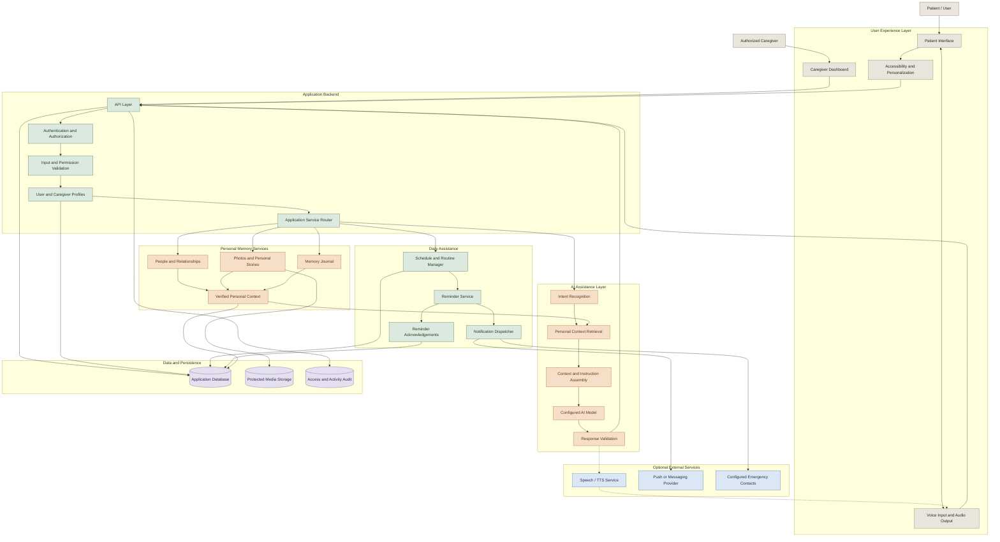

# MemoryMate 🧠
### AI-Assisted Memory Care and Daily Living Companion

**Supporting independence. Preserving meaningful connections. Helping caregivers provide better care.**

MemoryMate is an AI-assisted memory-care companion designed to support people experiencing memory difficulties, including people living with Alzheimer's disease, through personalized reminders, familiar memories, conversational assistance, and caregiver coordination.

The project aims to make everyday activities easier to navigate while helping families and caregivers stay connected with the people they support.

Rather than replacing human care, MemoryMate is designed to complement it with accessible technology, personalized assistance, and safety-conscious workflows.

> **Project principle:** Technology should support dignity, independence, and meaningful human connection—not replace caregivers or professional medical care.

---

## Table of Contents

- [Overview](#1-overview)
- [Problem Statement](#2-problem-statement)
- [Project Objectives](#3-project-objectives)
- [Key Features](#4-key-features)
- [System Architecture](#5-system-architecture)
- [Patient Workflow](#6-patient-workflow)
- [Caregiver Workflow](#7-caregiver-workflow)
- [AI Assistance Pipeline](#8-ai-assistance-pipeline)
- [Technology Stack](#9-technology-stack)
- [Core Modules](#10-core-modules)
- [Data Model](#11-data-model)
- [API Design](#12-api-design)
- [Privacy and Security](#13-privacy-and-security)
- [Accessibility and User Experience](#14-accessibility-and-user-experience)
- [Getting Started](#15-getting-started)
- [Testing and Evaluation](#16-testing-and-evaluation)
- [Limitations](#17-limitations)
- [Future Roadmap](#18-future-roadmap)
- [Contributing](#19-contributing)
- [License](#20-license)

## 1. Overview

Memory difficulties can make familiar daily activities challenging. Remembering appointments, following routines, recognizing important personal information, and coordinating with caregivers can become increasingly difficult over time.

MemoryMate explores how accessible AI and personalized digital tools can help with these everyday challenges.

The platform is designed around two complementary experiences:

- **Patient experience:** A simple, reassuring interface for reminders, daily routines, familiar people, and conversational assistance.
- **Caregiver experience:** Tools for managing routines, maintaining personalized information, coordinating support, and reviewing relevant updates.

The long-term vision is to create a memory-support ecosystem that combines personalized assistance with thoughtful accessibility and caregiver involvement.

## 2. Problem Statement

People experiencing memory difficulties may need repeated reminders, familiar guidance, and assistance navigating everyday activities. Caregivers may also need a more organized way to manage routines, appointments, and important personal information.

Existing digital tools can be difficult to navigate when they rely on dense interfaces, complicated settings, or interactions that require users to remember multiple steps.

MemoryMate aims to reduce this complexity through a familiar, accessible, and personalized experience.

## 3. Project Objectives

- Make everyday reminders easier to understand and follow.
- Support personalized routines and appointments.
- Provide access to meaningful personal memories and familiar people.
- Explore conversational AI for simple daily assistance.
- Help caregivers coordinate routine support.
- Design interfaces suitable for users with different levels of cognitive and technological ability.
- Protect personal information and preserve user dignity.
- Provide a foundation for future safety and accessibility integrations.

## 4. Key Features

### 4.1 Personalized Daily Reminders

Help users keep track of everyday activities through simple, understandable reminders.

Potential reminder categories include:

- Daily routines.
- Appointments and scheduled activities.
- Meals and hydration.
- Personal tasks.
- Family visits and social activities.
- Medication schedules configured by the user or caregiver.

Reminders should be configurable, easy to acknowledge, and presented using clear text and optional audio.

**Safety note:** MemoryMate should not independently change medication instructions, doses, or treatment schedules. Medication reminders must reflect an authorized schedule and should not be treated as confirmation that a dose was taken.

### 4.2 Memory Journal and Familiar People

Create a personalized space for meaningful information, including:

- Family photographs.
- Names and relationships.
- Important personal events.
- Favorite activities and interests.
- Familiar places.
- Personal notes and stories.

The purpose is to help users access information that is meaningful to them and encourage positive interaction with family members.

Personal memories should be added and maintained with appropriate permission and caregiver involvement where necessary.

### 4.3 Conversational AI Assistant

A conversational assistant can help users navigate the application and access configured information.

Example interactions:

- "What do I have planned today?"
- "Who is visiting me this afternoon?"
- "Show me pictures of my family."
- "What should I do next?"
- "Remind me about my appointment."

The assistant should use verified personal information and configured schedules rather than inventing events, relationships, or memories.

If the system cannot verify an answer, it should acknowledge that limitation and offer an appropriate next step.

### 4.4 Voice-Based Interaction

Voice interaction can make the platform more accessible for users who have difficulty navigating menus or typing.

Potential capabilities include:

- Speech-to-text input.
- Spoken responses.
- Voice-activated navigation.
- Audio reminders.
- Adjustable speech speed and volume.

Voice recognition should account for recognition errors, background noise, and language differences. Important actions should have a clear confirmation mechanism.

### 4.5 Caregiver Dashboard

A caregiver interface can provide authorized users with tools to:

- Create and manage reminders.
- Maintain personal information and family contacts.
- Configure daily routines.
- Review reminder acknowledgements where supported.
- Update appointments.
- Manage access to shared information.
- Configure appropriate emergency contacts.

The caregiver dashboard should expose only information necessary for the caregiver's authorized role.

### 4.6 Safety and Emergency Assistance

The platform can be extended with safety-focused functionality, such as:

- Emergency contact shortcuts.
- A clearly visible assistance button.
- Configurable caregiver contact information.
- Optional location-sharing workflows with appropriate consent.
- Notifications when supported safety conditions are met.

Emergency assistance must not be represented as a guaranteed emergency-response service. Delivery of notifications, connectivity, location accuracy, and recipient availability can fail.

### 4.7 Personalized Experience

Users should be able to receive assistance suited to their preferences and abilities.

Potential personalization options include:

- Preferred language.
- Text size and contrast.
- Reminder frequency.
- Preferred spoken voice.
- Familiar names and photographs.
- Simplified navigation.
- Caregiver-managed settings where authorized.

Personalization should be adjustable without making the patient interface unnecessarily complicated.

## 5. System Architecture

The following Mermaid diagram presents a modular reference architecture for MemoryMate, separating patient and caregiver interfaces, application services, AI assistance, personal data, and optional external integrations.



**Architecture note:** This is a proposed architecture, not a verified inventory of the existing repository. Authentication, AI providers, speech services, persistent storage, push notifications, and emergency integrations must be implemented and configured before being described as available product features.

## 6. Patient Workflow

The patient experience should minimize cognitive load and unnecessary decisions.

A typical interaction follows this sequence:

1. The user opens MemoryMate.
2. The application presents a simple home screen with the current day and the next relevant activity.
3. The user views a reminder, asks a question, or opens a familiar memory.
4. The system retrieves the relevant schedule or authorized personal information.
5. The application presents a short text response or spoken guidance.
6. The user can acknowledge a reminder or ask for clarification.
7. The system records the acknowledgement if that capability is implemented.

The application should never imply that a task was completed merely because a reminder was displayed.

## 7. Caregiver Workflow

The caregiver workflow focuses on setup, personalization, and coordination.

1. An authorized caregiver signs in.
2. The caregiver configures the user's preferences and permitted personal information.
3. The caregiver creates or updates routines and appointments.
4. The reminder service schedules the appropriate notifications.
5. The patient receives reminders through configured channels.
6. The application records relevant acknowledgements and delivery status where supported.
7. Authorized caregivers review the information needed to coordinate care.

Permissions should distinguish between viewing information, editing schedules, managing contacts, and changing security settings.

## 8. AI Assistance Pipeline

### 8.1 Intent Recognition

Determine what the user is asking for, such as a schedule lookup, a reminder, a family-memory request, or general application assistance.

### 8.2 Context Retrieval

Retrieve only the personal information required to answer the question. For example, a question about today's appointments should use the authorized schedule rather than unrelated family photographs or personal notes.

### 8.3 Response Generation

Generate a concise, understandable response using the retrieved information.

### 8.4 Response Validation

Before returning a response, verify that it:

- Does not invent appointments or personal relationships.
- Does not expose information the user is not authorized to access.
- Does not provide unsupported medical advice.
- Uses clear language and appropriate uncertainty.
- Does not claim an action succeeded unless the application confirms it.

### 8.5 Voice Processing

If voice services are implemented, the pipeline may include speech recognition, intent processing, response generation, and speech synthesis. Each stage should handle recognition failures and provide a fallback to text or manual interaction.

AI-generated responses should not be the only mechanism for critical reminders or emergency notifications.

## 9. Technology Stack

The final technology stack should reflect the existing implementation. A possible architecture includes:

| Layer | Possible technologies |
|---|---|
| Frontend | React, Next.js, or an existing mobile framework |
| Backend | Python with FastAPI or another existing API framework |
| Database | PostgreSQL or SQLite for a local prototype |
| ORM | SQLAlchemy or Prisma, depending on the backend |
| AI integration | Configured hosted models or compatible local models |
| Speech recognition | A supported speech-to-text engine |
| Speech synthesis | A supported text-to-speech engine |
| Scheduling | Background worker or persistent scheduler |
| Media storage | Protected local storage or private object storage |
| Testing | pytest and the frontend framework's testing tools |

These are implementation options, not a claim that every dependency is already installed.

## 10. Core Modules

### User and Caregiver Management

Manages profiles, account permissions, caregiver relationships, and preferences.

### Memory Journal

Stores authorized personal memories, family relationships, photographs, and associated metadata.

### Routine and Reminder Manager

Creates schedules, triggers reminders, records acknowledgements, and tracks delivery outcomes where available.

### AI Assistant

Handles intent recognition, personal-context retrieval, response generation, and validation.

### Voice Interface

Provides speech input and spoken responses if configured.

### Notification Service

Delivers reminders through supported channels and tracks delivery status where available.

### Safety and Emergency Module

Manages configured contact details and optional assistance workflows. It must report delivery failures honestly and must not claim to replace emergency services.

## 11. Data Model

A possible conceptual data model includes the following entities:

| Entity | Purpose |
|---|---|
| User | Patient or application user profile |
| Caregiver | Authorized caregiver identity |
| CareRelationship | Defines the caregiver's relationship and permissions |
| PersonalMemory | Personal notes, stories, and meaningful events |
| MemoryMedia | References to protected photographs or audio |
| Reminder | Reminder content, schedule, and configuration |
| ReminderEvent | Delivery, acknowledgement, or failure records |
| Conversation | Conversation metadata and ownership |
| ConversationMessage | Messages, subject to retention and access policies |
| EmergencyContact | Authorized emergency contact information |
| AuditEvent | Relevant access and security events |

The actual schema should enforce ownership and permissions at the data-access layer. Sensitive personal memories and media should not be publicly accessible.

## 12. API Design

Possible API capabilities include:

| Endpoint | Purpose |
|---|---|
| `GET /health` | Check application health |
| `GET /api/profile` | Retrieve the current authorized profile |
| `GET /api/today` | Retrieve the day's relevant activities |
| `GET /api/reminders` | List authorized reminders |
| `POST /api/reminders` | Create a reminder |
| `PATCH /api/reminders/{id}` | Update a reminder |
| `POST /api/reminders/{id}/acknowledge` | Record an acknowledgement |
| `GET /api/memories` | Retrieve authorized personal memories |
| `POST /api/memories` | Add a personal memory |
| `POST /api/assistant/chat` | Submit an assistant question |
| `GET /api/caregiver/overview` | Retrieve authorized caregiver information |

These are illustrative endpoint names. Document and expose them only if they are implemented in the application.

## 13. Privacy and Security

MemoryMate may handle sensitive personal information, including health-related context, family photographs, schedules, and location information. Privacy must be part of the architecture from the beginning.

- Apply authentication and authorization to protected endpoints.
- Enforce caregiver permissions on the server.
- Protect personal memories and media from public access.
- Store only the information necessary for the application's purpose.
- Avoid placing personal information in logs unnecessarily.
- Protect credentials and encryption keys.
- Use secure communication for remote deployments.
- Define data retention and deletion behavior.
- Obtain appropriate permission before sharing location or personal information.
- Clearly communicate when information is sent to an external AI or speech provider.
- Provide a way to review and correct stored personal information.
- Prevent AI-generated content from bypassing application access controls.

Emergency contacts and caregiver notifications must be protected against accidental or unauthorized changes.

## 14. Accessibility and User Experience

The patient-facing interface should be designed for clarity and familiarity.

### Visual design

- Large, readable typography.
- High-contrast text and controls.
- Clear icons paired with labels.
- Consistent navigation and button placement.
- Minimal clutter.
- Limited simultaneous choices.
- Clear confirmation and cancellation actions.

### Interaction design

- One primary action per screen where practical.
- Short instructions and simple language.
- Predictable navigation.
- Optional audio guidance.
- Adjustable text size and audio settings.
- Confirmation before consequential actions.
- A straightforward way to ask for help.

### Caregiver experience

The caregiver dashboard may provide more detailed controls, but should still use clear forms, accessible labels, and meaningful status messages.

The interface should be evaluated with intended users and caregivers wherever possible rather than assuming that a visually simple design is automatically cognitively accessible.

## 15. Getting Started

### Prerequisites

Depending on the actual implementation, you may need:

- A supported runtime such as Python or Node.js.
- Git.
- The project's dependencies.
- A configured AI or speech provider if the application requires one.
- A local database or configured database service.

### Clone the repository

```bash
git clone YOUR_REPOSITORY_URL
cd YOUR_PROJECT_DIRECTORY
```

Replace the placeholders with your actual repository URL and directory.

### Configure the environment

If the repository includes `.env.example`, copy it to a local environment file and configure the required settings.

Never commit real credentials or personal user data.

### Install dependencies

Follow the package manager and dependency files included in the repository. For a Python project with `requirements.txt`, the usual command is:

```bash
pip install -r requirements.txt
```

For a Node.js frontend with `package.json`, use the package manager specified by the project, for example:

```bash
npm install
```

### Start the application

Use the actual entry points defined by your codebase. For example, a FastAPI backend might start with:

```bash
uvicorn app.main:app --reload
```

A frontend might start with:

```bash
npm run dev
```

These are examples only. Confirm the real module paths, scripts, and configuration before documenting them as the project's supported startup commands.

## 16. Testing and Evaluation

MemoryMate should be evaluated for both software reliability and the quality of the user experience.

### Functional testing

- Reminder creation and scheduling.
- Reminder acknowledgement.
- Personal-memory creation and retrieval.
- Caregiver access controls.
- Conversation-context retrieval.
- Voice-service failure handling.
- Notification delivery status.
- Emergency-contact configuration.

### Security testing

- Unauthorized access to personal memories.
- Caregiver permission boundaries.
- Access to protected photographs and media.
- Sensitive information in logs.
- Session expiration and account access.
- Validation of external-service responses.

### AI quality testing

- Accuracy of schedule answers.
- Correct use of personal context.
- Unsupported or invented personal information.
- Response clarity and length.
- Appropriate uncertainty.
- Safe handling of medical questions.
- Behavior when information is unavailable.

### Usability testing

Evaluate whether users can understand reminders, locate familiar people, complete common tasks, and request help without excessive steps. Include caregivers in the evaluation process.

## 17. Limitations

- AI responses may be inaccurate or incomplete.
- MemoryMate is not a medical diagnostic or treatment system.
- Personal context is only reliable if it has been entered and maintained correctly.
- Voice recognition may fail because of noise, speech differences, or language limitations.
- Notifications depend on device permissions, connectivity, and service availability.
- Emergency workflows cannot guarantee that assistance will arrive.
- Users differ significantly in their preferences and support needs.

The application should be designed to fail safely, acknowledge uncertainty, and make human assistance accessible.

## 18. Future Roadmap

Potential future developments include:

- Voice-first daily assistance.
- Regional-language support.
- Family memory timelines and guided reminiscence.
- Caregiver-managed routines and personalized reminders.
- Secure family photograph and relationship management.
- Optional location-sharing workflows with consent.
- Reliable notification-delivery tracking.
- Offline access to selected routines and personal information.
- Improved personalization and accessibility settings.
- Evaluation of conversational accuracy and safety.
- Integration with approved care-management services.

Prioritize user safety, privacy, and usability over adding AI features for their own sake.

## 19. Contributing

Contributions are welcome.

1. Inspect the existing architecture and development conventions.
2. Keep patient, caregiver, AI, scheduling, and storage logic modular.
3. Add tests for new features and permission boundaries.
4. Document configuration and external dependencies.
5. Avoid committing secrets, personal information, photographs, or private conversation data.
6. Test accessibility and error states before submitting changes.

## 20. License

Refer to the repository's `LICENSE` file for the applicable licensing terms.

---

**MemoryMate — Supporting everyday independence through personalized assistance and meaningful human connection.**
